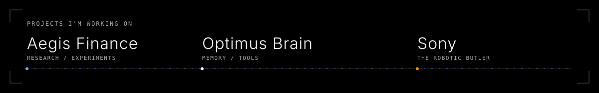
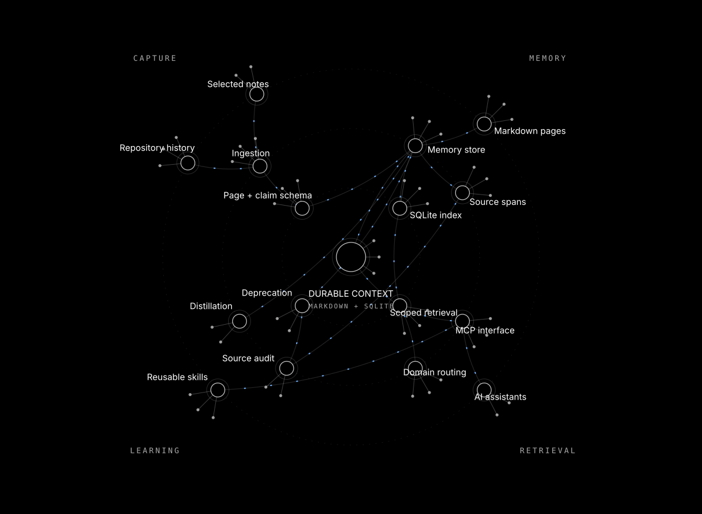
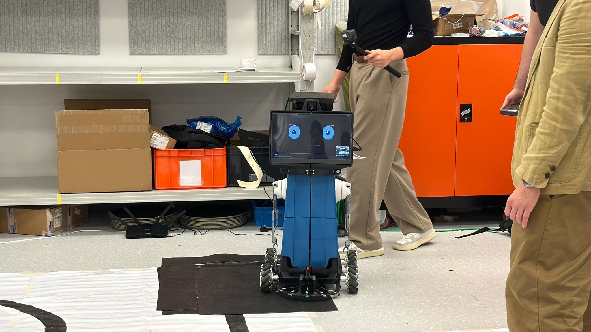

# Hi, I’m Murathan. I like building things.

[murathan.info](https://murathan.info)

### Aegis Finance

A work-in-progress market research system: gathering sources, testing ideas and keeping the evidence. The public showcase brings together its design, experiments and dated paper-account results.

[**Explore Aegis**](https://aegis-finance-showcase.vercel.app) · [Public repository](https://github.com/Murathanx12/AEGIS-FINANCE-SHOWCASE)

### Optimus Brain

Project memory and reusable tools for AI assistants. Sources, decisions and skills stay connected so a new session can find the work that came before it.

[**Explore Optimus**](https://optimus-brain-alpha.vercel.app) · [Repository](https://github.com/Murathanx12/Optimus)

### Sony the robotic butler

A robotic butler with mecanum wheels, computer vision, voice interaction and an expressive face. A team project connecting mechanical design, electronics and software.

[**Project & build notes**](https://github.com/Murathanx12/AR-2) · [Technical report](https://github.com/Murathanx12/AR-2/blob/main/docs/Sonny_Technical_Report.pdf)

### Web Portfolio Template

The open-source starting point for my portfolio, with interactive 3D models, a media library and room to make it your own.

[**Get the template**](https://github.com/Murathanx12/Web-Portfolio-Template) · [See my version](https://murathan.info)

<table>
<tr>
<td width="50%" valign="top">

### Journal & Letter

Private journals and shared letters that become a book, with real pages, drawings and export tools.

[Repository ↗](https://github.com/Murathanx12/Journal-Letter-)

</td>
<td width="50%" valign="top">

### RentMap HK

A student housing guide for exploring Hong Kong neighbourhoods, commutes and rental sources.

[Try RentMap ↗](https://rentmap-hk.vercel.app) · [Repository](https://github.com/Murathanx12/Rent-for-Students)

</td>
</tr>
</table>

A small side experiment: [the 2025 contribution-art view](https://github.com/Murathanx12?tab=overview&from=2025-01-01&to=2025-12-31).
